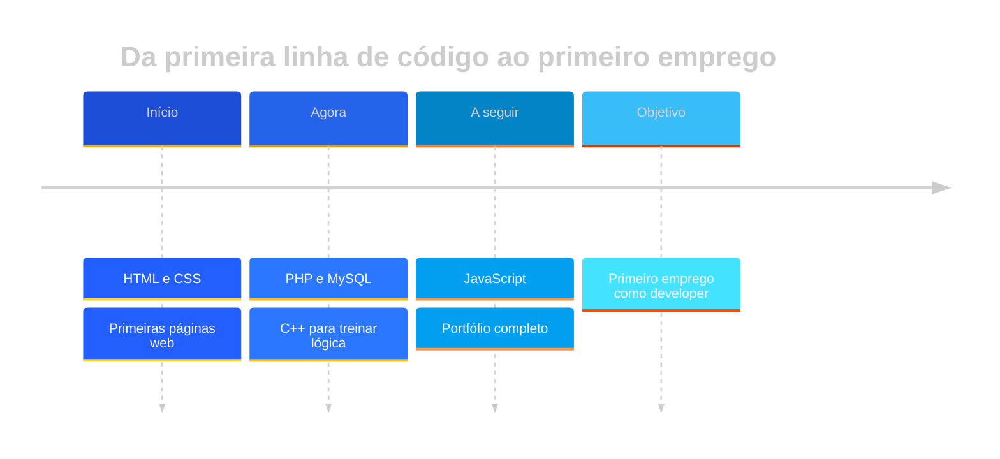

<!-- ═══════════════════════ HEADER (GIF animado) ═══════════════════════ -->

 

<a href="#sobre">Sobre</a> &nbsp;·&nbsp;
<a href="#stack">Stack</a> &nbsp;·&nbsp;
<a href="#projetos">Projetos</a> &nbsp;·&nbsp;
<a href="#estatisticas">Estatísticas</a> &nbsp;·&nbsp;
<a href="#percurso">Percurso</a> &nbsp;·&nbsp;
<a href="#contacto">Contacto</a>

  

 

<!-- ═══════════════════════ SOBRE ═══════════════════════ -->

<h2 align="center">Sobre mim</h2>

<table align="center">
<tr>
<td width="46%" valign="middle">

Olá! Eu sou o **Diogo Campelo**, estudante de **Desenvolvimento Web** a dar os primeiros passos no mundo do código.

Gosto de transformar ideias em páginas e programas que funcionam, e de aprender algo novo em cada projeto.

- 🔹 A aprofundar **HTML** e **CSS**
- 🔹 A aprender **PHP** e bases de dados
- 🔹 A treinar lógica com **C++**
- 🔹 Aberto a colaborações, feedback e novas ideias

> *"Primeiro faz funcionar, depois faz bonito."*

</td>
<td width="54%" align="center" valign="middle">
  
</td>
</tr>
</table>

 

<!-- ═══════════════════════ STACK ═══════════════════════ -->

<h2 align="center">Stack</h2>

  

| Tecnologia | Nível | Estado |
| :--- | :---: | :--- |
| **HTML** | ▰▰▰▰▰▰▰▱▱▱ | Intermédio |
| **CSS** | ▰▰▰▰▰▰▱▱▱▱ | Em progresso |
| **C++** | ▰▰▰▰▱▱▱▱▱▱ | Base sólida |
| **PHP** | ▰▰▰▱▱▱▱▱▱▱ | A aprender |

 

<!-- ═══════════════════════ PROJETOS ═══════════════════════ -->

<h2 align="center">Projetos em destaque</h2>

Troca <code>REPO_1</code> a <code>REPO_4</code> pelos nomes dos teus repositórios.

 

<!-- ═══════════════════════ ESTATÍSTICAS ═══════════════════════ -->

<h2 align="center">Estatísticas</h2>

 

 

 

<!-- ═══════════════════════ PERCURSO ═══════════════════════ -->

<h2 align="center">O meu percurso</h2>

 

<!-- ═══════════════════════ CONTACTO ═══════════════════════ -->

<h2 align="center">Vamos conversar?</h2>

**Tens uma ideia, um projeto ou queres trocar conhecimentos?**
 Escolhe o teu canal preferido!

  

 

<!-- ═══════════════════════ FOOTER (GIF animado) ═══════════════════════ -->

  

