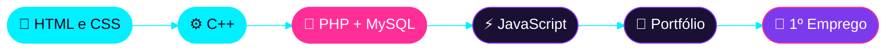

<!-- ╔═══════════════════════ HEADER ═══════════════════════╗ -->
<div align="center">


<!-- Terminal animado -->
<a href="https://git.io/typing-svg">
  
</a>

<br/>

<a href="#-ficha-de-personagem"><kbd> 🎮 Ficha </kbd></a>
<a href="#-skills-desbloqueadas"><kbd> 🧰 Skills </kbd></a>
<a href="#-missões"><kbd> 🚀 Missões </kbd></a>
<a href="#-estatísticas"><kbd> 📊 Stats </kbd></a>
<a href="#-roadmap"><kbd> 🗺️ Roadmap </kbd></a>
<a href="#-press-start"><kbd> 💬 Contacto </kbd></a>

<br/><br/>


</div>

<br/>

<!-- ╔═══════════════════════ FICHA ═══════════════════════╗ -->


<h2 align="center">🎮 Ficha de Personagem</h2>

<table align="center">
<tr>
<td width="58%" valign="middle">

```text
┌──────────────────────────────────────────────┐
│  PLAYER: Diogo Campelo                       │
│  CLASSE: Web Developer (em formação)         │
│  NÍVEL : 01  ▸  Aprendiz                     │
├──────────────────────────────────────────────┤
│  HTML   ██████████████░░░░░░  LVL 7          │
│  CSS    ████████████░░░░░░░░  LVL 6          │
│  C++    █████████░░░░░░░░░░░  LVL 4          │
│  PHP    ███████░░░░░░░░░░░░░  LVL 3          │
├──────────────────────────────────────────────┤
│  XP     ████████░░░░░░░░░░░░  em crescimento │
│  CAFÉ   ████████████████████  ∞              │
└──────────────────────────────────────────────┘
```

</td>
<td width="42%" align="center" valign="middle">
  
</td>
</tr>
</table>

<div align="center">

🔭 **Missão atual:** construir projetos para o portfólio &nbsp;·&nbsp; 🌱 **A estudar:** PHP & bases de dados
<br/>
🤝 **Aberto a:** colaborações, feedback e ideias &nbsp;·&nbsp; 💡 **Lema:** *"Primeiro faz funcionar, depois faz bonito."*

</div>

<br/>

<!-- ╔═══════════════════════ SKILLS ═══════════════════════╗ -->


<h2 align="center">🧰 Skills Desbloqueadas</h2>

<div align="center">

<a href="https://skillicons.dev">
  
</a>

<br/><br/>


<br/><br/>

🏆 
🏆 
🏆 

</div>

<details align="center">
<summary><b>💻 Clica aqui para ver o meu "Hello World"</b></summary>

```cpp
#include <iostream>

int main() {
    std::cout << "Olá, mundo! Eu sou o Diogo 👋" << std::endl;
    return 0;
}
```

</details>

<br/>

<!-- ╔═══════════════════════ MISSÕES ═══════════════════════╗ -->


<h2 align="center">🚀 Missões</h2>

<table align="center">
  <tr>
    <td width="50%" valign="top">
      <h3>🌐 Missão 01 — Landing Page</h3>
      
      <p>Site responsivo e moderno criado com HTML e CSS.</p>
      
      
      <br/><br/>
      <a href="https://github.com/YOUR_USERNAME/PROJETO_1"></a>
      <a href="https://LINK_DEMO_1"></a>
    </td>
    <td width="50%" valign="top">
      <h3>🐘 Missão 02 — Formulário PHP</h3>
      
      <p>Formulário de contacto com validação e envio em PHP.</p>
      
      
      <br/><br/>
      <a href="https://github.com/YOUR_USERNAME/PROJETO_2"></a>
      <a href="https://LINK_DEMO_2"></a>
    </td>
  </tr>
  <tr>
    <td width="50%" valign="top">
      <h3>⚙️ Missão 03 — Programa em C++</h3>
      
      <p>Aplicação de consola para praticar lógica e estruturas de dados.</p>
      
      <br/><br/>
      <a href="https://github.com/YOUR_USERNAME/PROJETO_3"></a>
    </td>
    <td width="50%" valign="top">
      <h3>✨ Missão 04 — Portfólio</h3>
      
      <p>O meu cantinho online com os meus trabalhos e a minha evolução.</p>
      
      
      <br/><br/>
      <a href="https://github.com/YOUR_USERNAME/PORTFOLIO"></a>
      <a href="https://YOUR_PORTFOLIO_URL"></a>
    </td>
  </tr>
</table>

<br/>

<!-- ╔═══════════════════════ ESTATÍSTICAS ═══════════════════════╗ -->


<h2 align="center">📊 Estatísticas</h2>

<div align="center">


<br/>


<br/>


<br/>


</div>

<br/>

<!-- ╔═══════════════════════ ROADMAP ═══════════════════════╗ -->


<h2 align="center">🗺️ Roadmap</h2>



<div align="center">

<sub>🟦 concluído &nbsp;·&nbsp; 🟪 em curso &nbsp;·&nbsp; ⬛ a seguir</sub>

</div>

<br/>

<!-- ╔═══════════════════════ CONTACTO ═══════════════════════╗ -->


<h2 align="center">💬 Press Start</h2>

<div align="center">


**Tens uma ideia, um projeto ou queres trocar conhecimentos?**
<br/>Escolhe o teu canal e vamos conversar!

<br/>

<a href="https://www.linkedin.com/in/YOUR_LINKEDIN/"></a>
<a href="mailto:YOUR_EMAIL@example.com"></a>
<a href="https://YOUR_PORTFOLIO_URL"></a>
<a href="https://instagram.com/YOUR_INSTAGRAM"></a>

<br/><br/>


<br/>

<a href="https://git.io/typing-svg">
  
</a>

</div>

<!-- ╔═══════════════════════ FOOTER ═══════════════════════╗ -->

