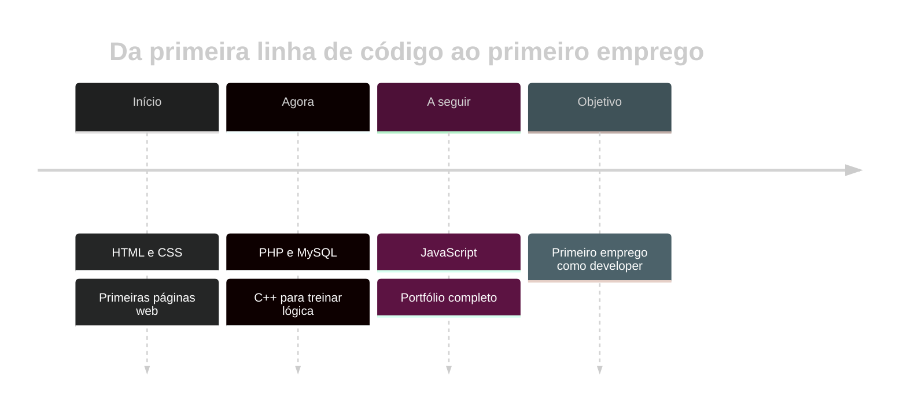

<!-- ═══════════════════════ HEADER ═══════════════════════ -->
<div align="center">


<a href="https://git.io/typing-svg">
  
</a>

<br/><br/>

<a href="#sobre">Sobre</a> &nbsp;·&nbsp;
<a href="#stack">Stack</a> &nbsp;·&nbsp;
<a href="#projetos">Projetos</a> &nbsp;·&nbsp;
<a href="#estatisticas">Estatísticas</a> &nbsp;·&nbsp;
<a href="#percurso">Percurso</a> &nbsp;·&nbsp;
<a href="#contacto">Contacto</a>

<br/><br/>


</div>

<br/>

<!-- ═══════════════════════ SOBRE ═══════════════════════ -->
<a id="sobre"></a>


<h2 align="center">👋 Sobre mim</h2>

<table align="center">
<tr>
<td width="58%" valign="middle">

Olá! Eu sou o **Diogo Campelo**, estudante de **Desenvolvimento Web** a dar os primeiros passos no mundo do código.

Gosto de transformar ideias em páginas e programas que funcionam, e de aprender algo novo em cada projeto.

- 🌱 A aprofundar **HTML** e **CSS**
- 🐘 A aprender **PHP** e bases de dados
- ⚙️ A treinar lógica com **C++**
- 🤝 Aberto a colaborações, feedback e novas ideias
- 💡 *"Primeiro faz funcionar, depois faz bonito."*

</td>
<td width="42%" align="center" valign="middle">
  
</td>
</tr>
</table>

<details>
<summary><b>💻 Clica aqui para veres o meu "Hello World"</b></summary>

```php
<?php
// O meu primeiro passo em PHP
$nome = "Diogo";
echo "Olá, mundo! Eu sou o $nome 👋";
```

</details>

<br/>

<!-- ═══════════════════════ STACK ═══════════════════════ -->
<a id="stack"></a>


<h2 align="center">🛠️ Stack</h2>

<div align="center">

<a href="https://skillicons.dev">
  
</a>

<br/><br/>

| Tecnologia | Nível | Estado |
| :--- | :---: | :--- |
| **HTML** | ▰▰▰▰▰▰▰▱▱▱ | Intermédio |
| **CSS** | ▰▰▰▰▰▰▱▱▱▱ | Em progresso |
| **C++** | ▰▰▰▰▱▱▱▱▱▱ | Base sólida |
| **PHP** | ▰▰▰▱▱▱▱▱▱▱ | A aprender |

</div>

<br/>

<!-- ═══════════════════════ PROJETOS ═══════════════════════ -->
<a id="projetos"></a>


<h2 align="center">🚀 Projetos em destaque</h2>

<div align="center">

<a href="https://github.com/YOUR_USERNAME/REPO_1">
  
</a>
<a href="https://github.com/YOUR_USERNAME/REPO_2">
  
</a>

<a href="https://github.com/YOUR_USERNAME/REPO_3">
  
</a>
<a href="https://github.com/YOUR_USERNAME/REPO_4">
  
</a>

<sub>💡 Troca <code>REPO_1</code> a <code>REPO_4</code> pelos nomes dos teus repositórios.</sub>

</div>

<br/>

<!-- ═══════════════════════ ESTATÍSTICAS ═══════════════════════ -->
<a id="estatisticas"></a>


<h2 align="center">📊 Estatísticas</h2>

<div align="center">


<br/>


<br/>


</div>

<br/>

<!-- ═══════════════════════ PERCURSO ═══════════════════════ -->
<a id="percurso"></a>


<h2 align="center">🧭 O meu percurso</h2>



<br/>

<!-- ═══════════════════════ CONTACTO ═══════════════════════ -->
<a id="contacto"></a>


<h2 align="center">💬 Vamos conversar?</h2>

<div align="center">


**Tens uma ideia, um projeto ou queres trocar conhecimentos?**
<br/>Escolhe o teu canal preferido!

<br/>

<a href="https://www.linkedin.com/in/YOUR_LINKEDIN/"></a>
<a href="mailto:YOUR_EMAIL@example.com"></a>
<a href="https://YOUR_PORTFOLIO_URL"></a>
<a href="https://instagram.com/YOUR_INSTAGRAM"></a>

<br/><br/>


<br/>

<a href="https://git.io/typing-svg">
  
</a>

</div>

<!-- ═══════════════════════ FOOTER ═══════════════════════ -->

